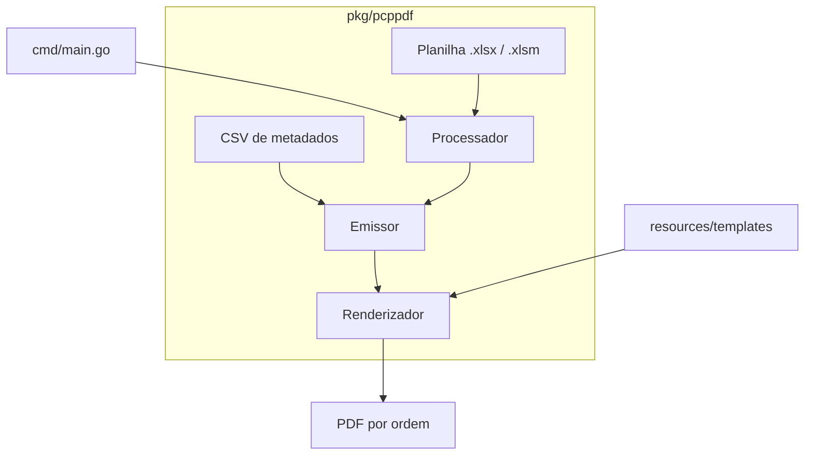

# SPDF: fichas de produção em PDF

### Sumário
- [`1.`](#1-resumo) **Resumo**

- [`2.`](#2-origem) **Origem**

- [`3.`](#3-primeira-execução) **Primeira execução**

- [`4.`](#4-para-ir-além) **Para ir além**

- [`5.`](#5-observações-finais) **Observações finais**

- [`6.`](#6-agradecimentos) **Agradecimentos**

## 1. Resumo

O SPDF lê uma planilha de programação de produção e gera uma ficha em PDF para cada ordem: uma página A4 em paisagem com o código e a descrição do produto, a data, a quantidade necessária, a classificação, o código de barras e os campos de preenchimento manual. Você aponta para a planilha, para um CSV com os dados cadastrais dos produtos, e ele devolve as fichas organizadas em uma pasta por data.



O `cmd/main.go` é a porta de entrada da linha de comando e conduz o pacote `pkg/pcppdf`. Dentro dele, o fluxo segue uma direção só: o `Processador` lê a planilha e separa as linhas com produção, o `Emissor` completa cada ordem com os dados do CSV e o `Renderizador` desenha o PDF usando as fontes de `resources/templates`.

Para rodar, você precisa do Go 1.22 ou superior. Todo o resto vem pelos módulos do Go.

## 2. Origem

Diariamente, o responsável pela emissão de ordens de produção separava entre uma e duas horas para realizar um processo inteiramente manual: copiar o código da planilha de programação, colar no template de ficha e imprimir, uma ficha por vez. Em períodos sazonais, essa carga podia ultrapassar as duas horas com facilidade, chegando de 200 a 500 ordens por dia.


Por se tratar de documentos destinados ao controle de produção, qualquer erro tinha impacto direto no processo fabril. Como o trabalho era manual, a tarefa era ao mesmo tempo repetitiva e suscetível a falhas operacionais. Era preciso um processo seguro, e daí vem o nome: SPDF, de *Security PDF*.

O projeto nasceu da observação de que, apesar da sensibilidade dos documentos gerados, o fluxo era inteiramente automatizável e aprimorável. Com a solução implementada, mais de 80% dos problemas operacionais foram eliminados. As falhas agora ocorrem apenas em situações de exceção muito raras, e a diferença em relação ao processo anterior é grande.

*Pode parecer algo simples, mas o SPDF mudou a forma como trabalhávamos diariamente.*

## 3. Primeira execução

Vamos gerar as fichas de uma planilha de exemplo que já vem no repositório. Os comandos abaixo valem para Linux e macOS; no Windows, use o terminal que preferir, desde que tenha o `make` (ou rode o `go run` direto, mostrado mais adiante).

**1. Baixe as dependências.**

```bash
go mod download
```

**2. Dê uma olhada na planilha.** Antes de gerar qualquer coisa, vale conferir em quais colunas estão o código, a descrição e as quantidades. O modo de inspeção lista o que há nas primeiras linhas:

```bash
make inspect FILE=resources/metalurgica.bicicletas/dFato.xlsm
```

Cada linha de saída traz o índice da coluna (começando em zero) e o conteúdo da célula. Esses índices são os mesmos que as flags `-code-col`, `-desc-col` e `-date-cols` esperam.

**3. Gere as fichas.**

```bash
make pdfs OUT=out/
```

O `Makefile` já traz os índices corretos para a planilha de exemplo. Ao final, o terminal mostra um resumo:

```
--- Resumo Final ---
Linhas com produção identificadas: 26
Total de ordens individuais: 182
Fichas PDF geradas com sucesso: 182
Produtos ausentes no cadastro (CSV): 0
```

Em um teste com essa planilha, as 182 fichas saíram em cerca de cinco segundos.

**4. Abra uma ficha.** As fichas ficam em `out/<data>/<CODIGO> [<data>].pdf`. Na planilha de exemplo, as datas vêm no formato `2024-06-03`, então a primeira ficha é `out/20240603/10001-1 [20240603].pdf`. Se a sua planilha trouxer datas como `03/06/2024`, o nome da pasta fica `03.06.2024` e a ficha mostra também o dia da semana.

Sem o `make`, o mesmo comando é:

```bash
go run ./cmd \
    -xls "resources/metalurgica.bicicletas/dFato.xlsm" \
    -sheet "RELATORIO PP GERAL" \
    -date-cols "12,15,18,21,24,27,30" \
    -code-col 2 -desc-col 3 -start-line 5 -date-line 0 \
    -meta "resources/metalurgica.bicicletas/dim_Items.CSV" \
    -template "resources/templates/template.html" \
    -out "out/"
```

Para testar o código, rode `go test ./...`.

## 4. Para ir além

A documentação técnica completa está em [`docs/Codigo.md`](docs/Codigo.md). Ela explica como cada etapa funciona, lista todos os parâmetros e tipos, descreve o que acontece quando algo dá errado e mostra como adaptar o projeto à sua planilha.

| Quero... | Vá para |
|---|---|
| Entender o que cada flag faz | [Execução](docs/Codigo.md#31-execução) e [Configuração](docs/Codigo.md#32-configuração) |
| Adaptar o SPDF a outra planilha | [Como adaptar a uma nova planilha](docs/Codigo.md#71-como-adaptar-a-uma-nova-planilha) |
| Acrescentar um campo à ficha | [Como acrescentar um campo à ficha](docs/Codigo.md#72-como-acrescentar-um-campo-à-ficha) |
| Saber o que acontece em caso de erro | [Tratamento de erros](docs/Codigo.md#5-tratamento-de-erros) |
| Conhecer os limites do projeto | [Garantias e limitações](docs/Codigo.md#6-garantias-e-limitações) |

## 5. Agradecimentos

Ao time de Programação e Controle de Produção *(PCP)*, pelo apoio durante o desenvolvimento: os reais responsáveis por todo o processo. Foi um dos projetos mais divertidos que já trabalhei em equipe, e eles mudaram a forma como enxergo colaboração e desenvolvimento. Grande parceria.
