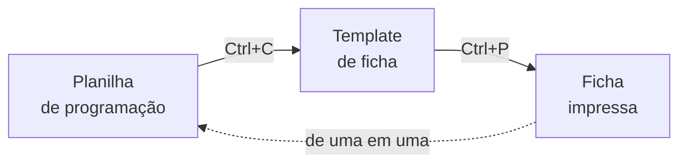
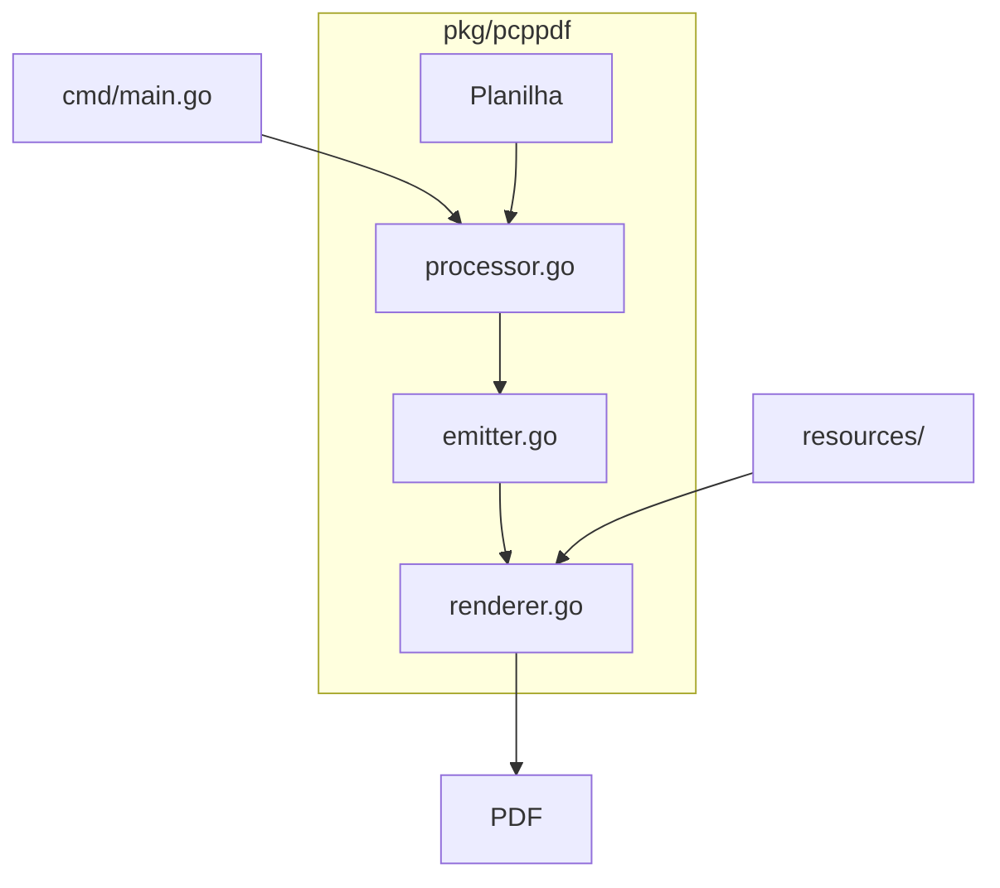

# SPDF 

> Gerador de Ordens de Ordens de produção em PDF fazendo enrich de planilhas de controle (`.xlsm`).

---

## Origem — Security PDF

Diariamente, o responsável pela emissão de ordens de produção *(esse processo que diz oque apontadores de produão devem fazer)* separava entre uma e duas horas para realizar um processo inteiramente manual: copiar o código da planilha de programação, colar no template de ficha e imprimir — uma ficha por vez. Em períodos sazonais, essa carga podia ultrapassar as duas horas com facilidade.

### Resumo do processo manual



Por se tratar de documentos destinados ao controle de produção, qualquer erro tinha impacto direto no processo fabril. A tarefa era ao mesmo tempo repetitiva e suscetível a falhas operacionais e imprevistos.

E por isso precisava ser algo seguro para este processo, dali o nome SPDF.

O projeto nasceu da observação de que, apesar da sensibilidade dos documentos gerados, o fluxo era inteiramente automatizável — e aprimorável. Com a solução implementada, mais de 80% dos problemas operacionais foram eliminados. Falhas agora ocorrem apenas em situações de exceção muito raras, e a diferença em relação ao processo anterior é imediatamente perceptível nos registros.
*Pode parecer algo simples, mas SPDF mudou a forma como trabalhavamos diáriamente.*
## Agradecimentos

Ao time de Programção e Controle de Produção *(PCP)* pelo apoio durante o desenvolvimento —
os reais responsáveis por todo o processo. Foi um dos projetos mais divertidos
que já trabalhei em equipe, e eles mudaram a forma como enxergo colaboração
no desenvolvimento. Grande parceria. 


---

## Resumo e ínicio do Projeto



O `cmd/main.go` atua como ponto de entrada da CLI, orquestrando o pacote `pkg/pcppdf`. Dentro dele, o pipeline segue uma direção linear: o `processor.go` lê e normaliza os dados da planilha, o `emitter.go` converte esses dados em contexto de renderização, e o `renderer.go` gera o PDF final — consumindo os templates, estilos e fontes em `resources/`.

---

## Parâmetros principais

Configuráveis via `Makefile` ou flags diretas na CLI.

| Parâmetro | Tipo | Descrição |
|-----------|------|-----------|
| `XLS` | `string` | Caminho do arquivo `.xlsm` |
| `SHEET` | `string` | Nome da aba (ex: `"RELATÓRIO PP GERAL"`) |
| `DATE_COLS` | `[]int` | Índices das colunas com quantidades de produção (base zero) |
| `CODE_COL` | `int` | Índice da coluna do código do produto |
| `DESC_COL` | `int` | Índice da coluna da descrição |
| `START_LINE` | `int` | Linha onde começam os dados dos produtos |
| `DATE_LINE` | `int` | Linha onde estão os cabeçalhos de data |
| `LOG` | `bool` | Emite log como proxy de I/O |
| `LOG_DIR` | `string` | Caminho do arquivo de log a ser salvo |
| `VERBOSE` | `bool` | Exibe resultado detalhado no terminal após a execução |

---

## Estrutura do projeto

```
.
├── cmd/
│   └── main.go                  # Ponto de entrada da CLI; parse de flags; orquestra o pacote pcppdf
│
├── pkg/pcppdf/
│   ├── processor.go             # Leitura e iteração sobre a planilha; normalização de registros
│   ├── emitter.go               # Converte modelos em contexto de renderização para templates e PDF
│   ├── renderer.go              # Gera o PDF final; trata paginação e exportação
│   ├── metadata.go              # Extração e normalização de metadados (datas, códigos, descrições)
│   ├── format.go                # Formatação de datas, números e códigos de barras
│   ├── config.go                # Carregamento de configurações e caminhos (templates, fontes, render)
│   ├── options.go               # Flags e opções do módulo (diretório de saída, template a usar)
│   ├── types.go                 # Structs e tipos centrais do domínio (Produto, Lote, Ficha...)
│   ├── errors.go                # Erros customizados e helpers para propagação de falhas
│   └── *_test.go                # Testes unitários de parsing, formatação e integração
│
├── resources/
│   ├── templates/
│   │   ├── template.html        # Layout base do PDF
│   │   ├── style.css            # Estilos aplicados durante a renderização
│   │   ├── arial.ttf            # Fonte embarcada para render consistente
│   │   └── Code39AzaleaRegular3.ttf  # Fonte para geração de códigos de barras
│   └── meta/
│       ├── qsort.CSV            # Arquivo auxiliar para exemplos e testes
│       └── dados.CSV            # Arquivo auxiliar para exemplos e testes
│
├── go.mod
└── go.sum
```

---

## Comandos

```bash
# Executar todos os testes
go test ./...

# Processar uma planilha de exemplo
go run ./cmd
```

---

## Notas de desenvolvimento

> **Memória com Excelize:** utilize sempre `Rows()` com streaming. Nunca use `GetRows()` ou `GetCellValue()` dentro de loops grandes — ambos carregam a planilha inteira na memória e estouram a RAM em ambientes com recursos limitados.

### Observações Finais

Este repositório representa apenas uma parte do projeto. O SPDF completo possui
interface gráfica e foi desenvolvido em Java com Apache POI, conexão JDBC para
metadados atualizados e arquivos de configuração *(strings de conexão e acesso a outros servidores)* criptografados em AES-GCM.

O Original também contem cache de arquivos metadados — necessário porque no
setor de produção é comum operadores abrirem o sistema repetidamente para emitir
inclusões (pedidos fora da programação semanal ou por encomenda).

---

## Projetos Relacionados

- [Java_SafeAES_Json](https://github.com/RichardAlves8/Java_SafeAES_Json) —
  Criei e *já reutilizei em outros*  para criptografar os arquivos de configuração

- [ChangePass XLS](https://github.com/RichardAlves8/Passd_Xls) —
  se você já perdeu controle de credenciais embutidas em planilhas Excel
  *(strings de conexão OLE DB)*, vale a leitura!