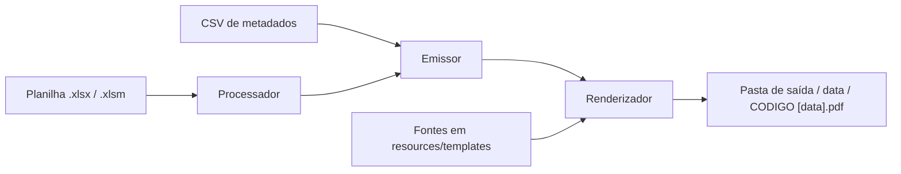
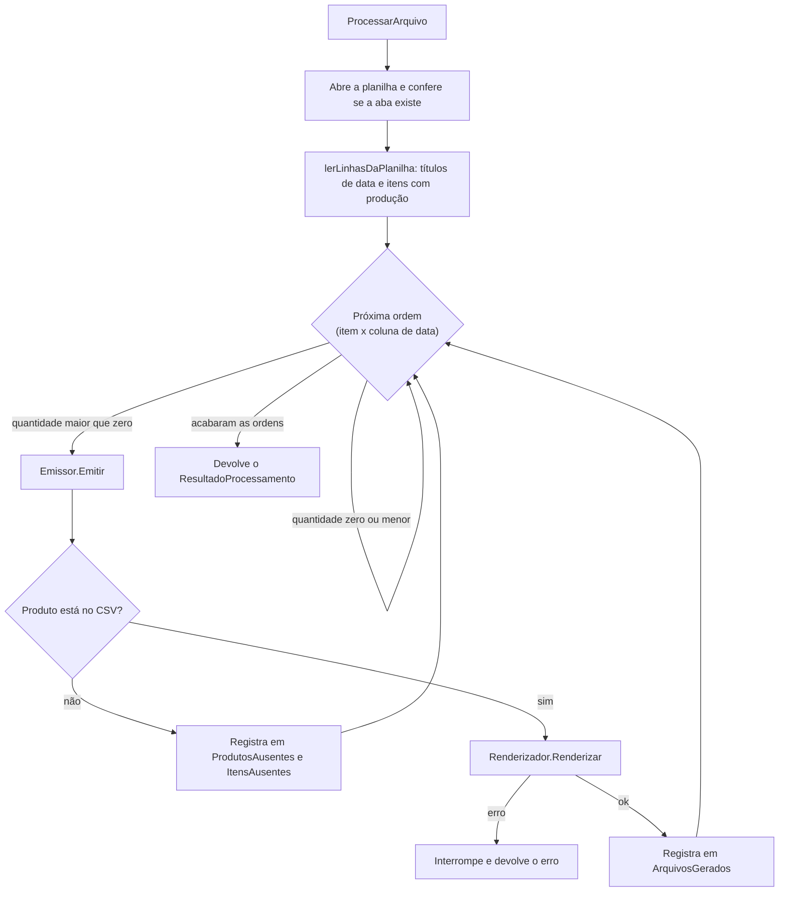

# SPDF: leitura da planilha e emissão das fichas

### Sumário
- [`1.`](#1-resumo) **Resumo**

- [`2.`](#2-estrutura-e-instalação) **Estrutura e instalação**

- **3. Uso (`cmd/main.go`)**
  - [`3.1`](#31-execução) Execução
  - [`3.2`](#32-configuração) Configuração
  - [`3.3`](#33-formato-do-csv-de-metadados) Formato do CSV de metadados

- **4. Fluxo detalhado (`pkg/pcppdf`)**
  - [`4.1`](#41-orquestração) Orquestração
  - [`4.2`](#42-leitura) Leitura
  - [`4.3`](#43-emissão) Emissão
  - [`4.4`](#44-renderização) Renderização
  - [`4.5`](#45-saída-no-terminal-e-log) Saída no terminal e log
  - [`4.6`](#46-tipos-e-dados-do-template) Tipos e dados do template

- [`5.`](#5-tratamento-de-erros) **Tratamento de erros**

- [`6.`](#6-garantias-e-limitações) **Garantias e limitações**

- **7. Como estender**
  - [`7.1`](#71-como-adaptar-a-uma-nova-planilha) Como adaptar a uma nova planilha
  - [`7.2`](#72-como-acrescentar-um-campo-à-ficha) Como acrescentar um campo à ficha
  - [`7.3`](#73-como-criar-um-novo-renderizador) Como criar um novo renderizador
  - [`7.4`](#74-como-trocar-o-título-da-ficha) Como trocar o título da ficha

- **8. Convenções do código**
  - [`8.1`](#81-comentários) Comentários
  - [`8.2`](#82-nomes) Nomes

- [`9.`](#9-testes) **Testes**

## 1. Resumo

O SPDF faz três coisas em sequência: lê uma planilha de programação de produção, completa cada ordem com os dados cadastrais do produto e desenha uma ficha em PDF para cada ordem. A planilha diz **o que** produzir, **quanto** e **quando**. O CSV de metadados diz **quem é** o produto (código de barras, seção e subgrupo). A ficha junta as duas coisas.



Existe um único programa de linha de comando (`cmd/main.go`) e um único pacote (`pkg/pcppdf`). O programa só lê as flags e entrega a configuração ao pacote. Todo o trabalho acontece dentro dele.

| Arquivo | Papel | Entrada | Saída |
|---|---|---|---|
| `cmd/main.go` | Lê as flags, monta a saída (terminal e log), chama o pacote e imprime o resumo. Também tem o modo de inspeção | Flags | Fichas em PDF, resumo e log |
| `pkg/pcppdf/doc.go` | Documentação do pacote | - | - |
| `pkg/pcppdf/processor.go` | `Processador`: percorre a planilha e pede a emissão de cada ordem | Planilha | `ResultadoProcessamento` |
| `pkg/pcppdf/emitter.go` | `Emissor`: busca os metadados, monta os dados da ficha e define o caminho do arquivo | Pedido de emissão | `ArquivoGerado` |
| `pkg/pcppdf/renderer.go` | `Renderizador` e seus dois motores: `RenderizadorGoPDF` (PDF) e `RenderizadorArquivo` (texto/HTML) | Dados da ficha | Arquivo em disco |
| `pkg/pcppdf/metadata.go` | Leitura do CSV de metadados | CSV | Mapa de `InformacaoProduto` |
| `pkg/pcppdf/format.go` | Funções pequenas de formatação: código, número, data e texto | - | - |
| `pkg/pcppdf/config.go` | `Configuracao` e sua validação | - | - |
| `pkg/pcppdf/options.go` | Opções funcionais do `Processador` | - | - |
| `pkg/pcppdf/types.go` | Tipos de dados compartilhados | - | - |
| `pkg/pcppdf/errors.go` | Erros do pacote | - | - |

## 2. Estrutura e instalação

Tudo vive em um único módulo Go, chamado `spdf-pcppdf-go`.

```
.
├── cmd/
│   └── main.go                       (ponto de entrada da linha de comando)
├── pkg/pcppdf/
│   ├── doc.go
│   ├── processor.go
│   ├── emitter.go
│   ├── renderer.go
│   ├── metadata.go
│   ├── format.go
│   ├── config.go
│   ├── options.go
│   ├── types.go
│   ├── errors.go
│   └── *_test.go                     (testes unitários e de integração)
├── resources/
│   ├── templates/
│   │   ├── template.html             (layout para o RenderizadorArquivo)
│   │   ├── style.css                 (estilos do template HTML)
│   │   ├── arial.ttf                 (fonte do texto, embarcada no PDF)
│   │   └── Code39AzaleaRegular3.ttf  (fonte do código de barras)
│   ├── metalurgica.bicicletas/       (exemplo: dFato.xlsm e dim_Items.CSV)
│   ├── grafica/                      (exemplo)
│   └── viveiro.florestal/            (exemplo)
├── docs/
│   └── Codigo.md                     (este arquivo)
├── Makefile
├── go.mod
├── go.sum
└── README.md
```

Você precisa do **Go 1.22 ou superior**. O projeto usa duas bibliotecas, que o Go baixa sozinho:

| Biblioteca | Versão | Para que serve |
|---|---|---|
| `github.com/xuri/excelize/v2` | v2.9.0 | Ler a planilha `.xlsx` / `.xlsm` |
| `github.com/signintech/gopdf` | v0.36.1 | Desenhar o PDF |

```bash
go mod download      # baixa as dependências
go build -o spdf ./cmd   # gera o executável (opcional)
go test ./...        # roda os testes
```

As pastas de exemplo em `resources/` têm o mesmo layout de planilha. Cada uma traz um `dFato.xlsm` (a programação) e um `dim_Items.CSV` (os metadados). Elas servem para você testar sem mexer em dados reais.

## 3. Uso: `cmd/main.go`

### 3.1 Execução

Há dois modos de uso. O modo normal gera as fichas. O modo de inspeção só mostra o que existe na planilha e serve para descobrir os índices das colunas.

```bash
# Gerar as fichas (pelo Makefile, com os valores do exemplo)
make pdfs

# Gerar as fichas, trocando alguns valores
make pdfs FILE=resources/grafica/dFato.xlsm META=resources/grafica/dim_Items.CSV OUT=out/

# Gerar as fichas sem o Makefile
go run ./cmd -xls "planilha.xlsm" -sheet "NOME DA ABA" -date-cols "12,15,18" \
    -meta "metadados.csv" -template "resources/templates/template.html" -out "out/"

# Inspecionar a planilha
make inspect
go run ./cmd -xls "planilha.xlsm" -sheet "NOME DA ABA" -inspect -inspect-rows 8 -inspect-cols 40
```

Antes de processar qualquer coisa, o programa confere a entrada e encerra com código `1` e uma mensagem no terminal se algo estiver errado:

- A flag `-xls` é obrigatória.
- `-date-cols` precisa ser uma lista de números separados por vírgula e não pode ficar vazia (exceto no modo de inspeção, que ignora essa flag).
- A configuração precisa estar completa: template, nome da aba, colunas de data, pasta de saída e CSV de metadados. O CSV também precisa existir e poder ser lido.

Ao terminar, o programa imprime um resumo. Repare que **produto sem cadastro não é erro**: ele aparece no resumo e no log, mas o código de saída continua `0`. Para saber o que aconteceu com cada ordem, use `-verbose` ou `-log` ([seção 4.5](#45-saída-no-terminal-e-log)).

### 3.2 Configuração

Cada parâmetro tem três nomes, porque aparece em três lugares: a flag da linha de comando, a variável do `Makefile` e o campo de `Configuracao`. Os nomes das flags e das variáveis do `Makefile` são a interface externa do programa e **não mudam** quando o código é reorganizado.

Os índices de coluna e de linha começam em zero.

| Flag | Variável do `Makefile` | Campo de `Configuracao` | Padrão da flag | Padrão do `Makefile` | Descrição |
|---|---|---|---|---|---|
| `-xls` | `FILE` | (argumento de `ProcessarArquivo`) | - (obrigatória) | `resources/metalurgica.bicicletas/dFato.xlsm` | Planilha `.xlsx` ou `.xlsm` |
| `-sheet` | `SHEET` | `NomeAbaPCP` | `RELATÓRIO PP GERAL` | `RELATORIO PP GERAL` | Nome da aba |
| `-meta` | `META` | `CaminhoCSVMetadados` | `../resources/meta/dados.CSV` | `resources/metalurgica.bicicletas/dim_Items.CSV` | CSV de metadados |
| `-template` | `TEMPLATE` | `CaminhoTemplateHTML` | `../resources/templates/template.html` | `resources/templates/template.html` | Template base. As fontes são procuradas na mesma pasta |
| `-out` | `OUT` | `PastaOrdensPCP` | `out/` | `../SPDF (out)/` | Pasta de saída dos PDFs |
| `-date-cols` | `DATE_COLS` | `ColunasDeData` | `12,15,18,21,24,27,30,33,35,37,39` | `12,15,18,21,24,27,30` | Colunas com a quantidade de cada data |
| `-code-col` | `CODE_COL` | `ColunaCodigo` | `2` | `2` | Coluna do código do produto |
| `-desc-col` | `DESC_COL` | `ColunaDescricao` | `3` | `3` | Coluna da descrição |
| `-start-line` | `START_LINE` | `LinhaInicialDosDados` | `5` | `5` | Primeira linha de produtos; as anteriores são cabeçalho |
| `-date-line` | `DATE_LINE` | `LinhaDasDatas` | `0` | `0` | Linha com os títulos de data |
| `-inclusion-out` | - | `PastaOrdensInclusao` | vazio | - | Pasta das ordens de inclusão (veja a [seção 6](#6-garantias-e-limitações)) |
| `-verbose` | `VERBOSE` | - | `false` | `false` | Mostra os detalhes de cada ordem no terminal |
| `-log` | `LOG` | - | `false` | `true` | Grava os detalhes em um arquivo de log |
| `-log-dir` | `LOGDIR` | - | `logs` | `Logs/` | Pasta dos arquivos de log |
| `-inspect` | (alvo `inspect`) | - | `false` | - | Liga o modo de inspeção |
| `-inspect-rows` | `INSPECT_ROWS` | - | `8` | `5` | Quantas linhas inspecionar |
| `-inspect-cols` | `INSPECT_COLS` | - | `20` | `72` | Quantas colunas inspecionar |

Duas coisas valem uma atenção especial:

- **Os padrões de `-meta` e `-template` partem da pasta `cmd/`.** Eles só funcionam se você executar o programa de dentro dessa pasta. Na prática, passe sempre as duas flags (o `Makefile` já faz isso).
- **A pasta de saída padrão do `Makefile` fica fora do repositório** (`../SPDF (out)/`). Se você prefere que as fichas fiquem dentro do projeto, use `make pdfs OUT=out/`.

#### Como o exemplo é montado

Nas planilhas de exemplo, o cabeçalho com as datas está na linha 0 e os produtos começam na linha 5. Cada data ocupa três colunas seguidas, todas com o mesmo título de data, e o `Makefile` usa a coluna do meio de cada trio (12, 15, 18, ...). A coluna 2 tem o código com dígito verificador (como `10001-1`) e a coluna 3, a descrição. Linhas de subtotal, como `QUADROS Total`, não têm quantidade nas colunas escolhidas e por isso são ignoradas sem aviso.

### 3.3 Formato do CSV de metadados

O CSV é a fonte dos dados cadastrais. Ele é lido uma única vez, no início, e fica em memória.

```
CODIGO;PRODUTO;EAN13;SECAO;SUBGRUPO
10001-1;QUADRO MTB 29 ALUMINIO TAM P;30010001;QUADROS;MTB
```

| Coluna | Uso |
|---|---|
| `CODIGO` | Chave de busca. Precisa ser igual ao código da planilha |
| `PRODUTO` | Lida, mas **não impressa**: a ficha mostra a descrição da planilha |
| `EAN13` | Vira o código de barras e o número impresso abaixo dele |
| `SECAO` | Impressa como `CLASS/EST` |
| `SUBGRUPO` | Impresso como `TIPO` |

As regras de leitura:

- O separador é o ponto e vírgula, o mais comum em exportações de ERPs brasileiros.
- A primeira linha é sempre tratada como cabeçalho e descartada.
- Linhas com menos de cinco campos são ignoradas.
- Espaços nas pontas de cada campo são removidos.
- Se um código aparecer mais de uma vez, vale a última ocorrência.
- O `EAN13` não é validado. Qualquer texto vira código de barras, e nos arquivos de exemplo ele tem oito dígitos, não treze.

## 4. Fluxo detalhado: `pkg/pcppdf`

Esta seção mostra o que acontece por dentro, na ordem em que acontece. Leia a orquestração para ter a visão geral e consulte as tabelas quando precisar localizar algo no código.

### 4.1 Orquestração

O `main` cria um `Processador` com `NovoProcessador` e chama `ProcessarArquivo`. Daí em diante, o fluxo é este:



A unidade de trabalho é a **ordem**: um item (uma linha da planilha) em uma data (uma coluna). Uma linha com quantidades em quatro datas gera quatro fichas. As ordens são processadas em sequência, linha a linha e, dentro de cada linha, na ordem em que as colunas aparecem em `-date-cols`.

| Função | Papel |
|---|---|
| `NovoProcessador` | Valida a `Configuracao`, aplica as opções e, se os metadados não vieram por opção, carrega o CSV |
| `ProcessarArquivo` | Abre a planilha, lê as linhas, emite cada ordem e consolida o resultado |
| `lerLinhasDaPlanilha` | Percorre a planilha uma única vez e devolve as datas e os itens com produção |
| `itemPlanejadoDaLinha` | Converte uma linha em `ItemPlanejado`; ignora a linha se nenhuma data tem quantidade maior que zero |
| `valorDaColuna` | Lê uma coluna sem causar erro quando o índice passa do tamanho da linha |

### 4.2 Leitura

A planilha pode ser grande, e carregá-la inteira na memória estoura a RAM de máquinas modestas. Por isso o `ProcessarArquivo` usa `Rows()` do `excelize`, que lê linha a linha (streaming), e nunca `GetRows()` nem `GetCellValue()` dentro de laços grandes.

A leitura faz duas coisas na mesma passada:

1. Na linha `LinhaDasDatas`, guarda o título de cada coluna de data, no valor bruto e já formatado.
2. Da linha `LinhaInicialDosDados` em diante, cria um `ItemPlanejado` para cada linha que tenha quantidade maior que zero em pelo menos uma coluna de data.

Os valores passam por pequenas funções de `format.go`:

| Função | O que faz | Exemplo |
|---|---|---|
| `normalizarCodigo` | Remove espaços das pontas e o sufixo `.0` que o Excel acrescenta a números | `"123-4.0"` vira `"123-4"` |
| `converterDecimal` | Converte texto em número, aceitando vírgula decimal. Vazio, `0` ou texto inválido viram zero | `"12,5"` vira `12.5` |
| `formatarDataPTBR` | Acrescenta o dia da semana a uma data `DD/MM/AAAA` (ou `DD.MM.AAAA`) | `"29/05/2026"` vira `"Sexta — 29/05/2026"` |
| `dataNumericaParaCaminho` | Mantém só dígitos, pontos e barras e troca as barras por pontos | `"Sexta — 29/05/2026"` vira `"29.05.2026"` |
| `valorComoTexto` | Converte qualquer valor em texto; `nil` vira texto vazio | - |

**O que acontece com datas fora do padrão.** `formatarDataPTBR` só reconhece `DD/MM/AAAA`. Qualquer outro formato volta como estava. É o caso das planilhas de exemplo, cujas datas são `2024-06-03`: a ficha mostra `2024-06-03` no campo de data, e o nome da pasta fica `20240603`, porque `dataNumericaParaCaminho` descarta o hífen.

### 4.3 Emissão

O `Emissor` recebe um `PedidoDeEmissao` e devolve três coisas: o `ArquivoGerado`, o código do produto ausente (quando for o caso) e um erro. A segunda saída existe para que a falta de cadastro seja um resultado comum, e não uma falha que derrube o processamento.

Em `Emitir`, as etapas são:

1. Normaliza o código (`normalizarCodigo`).
2. Busca o produto (`buscarProduto`). Se não achar, devolve o código e para por aqui.
3. Monta os dados da ficha ([seção 4.6](#46-tipos-e-dados-do-template)).
4. Calcula o caminho do arquivo (`caminhoDeSaida`), criando a pasta da data se preciso.
5. Chama o `Renderizador`.

**A busca com segunda tentativa.** A planilha às vezes traz `1234` enquanto o CSV guarda `123-4`, com o dígito verificador separado por hífen. Se a busca direta falhar, `buscarProduto` tenta de novo com `formatarCodigoComDigito`, que insere o hífen antes do último caractere. A segunda tentativa só acontece se o código tiver pelo menos dois caracteres e ainda não tiver hífen.

**Onde o arquivo é gravado.** O caminho segue sempre o padrão:

```
<pasta de saída>/<data>/<CODIGO> [<data>].pdf
```

A data do caminho vem de `dataNumericaParaCaminho`. Uma ordem marcada como `Inclusao` iria para `PastaOrdensInclusao`, se ela estiver preenchida, e mostraria `inclusao` no rodapé no lugar do número. O `Processador` atual, porém, nunca marca uma ordem como inclusão ([seção 6](#6-garantias-e-limitações)).

| Função | Papel |
|---|---|
| `Emitir` | Executa o ciclo completo de uma ordem |
| `buscarProduto` | Busca o produto nos metadados, com a segunda tentativa |
| `formatarCodigoComDigito` | Insere o hífen do dígito verificador |
| `contemHifen` | Informa se o texto tem hífen |
| `caminhoDeSaida` | Define a pasta e o nome do arquivo e cria a pasta |
| `numeroDaOrdem` | Texto do rodapé: o número da ordem, ou `inclusao` |

### 4.4 Renderização

O `Renderizador` é uma interface com um único método, `Renderizar`. Isso permite trocar a forma de gerar o documento sem tocar no resto do fluxo. Existem dois motores:

| Motor | Para que serve | O que grava |
|---|---|---|
| `RenderizadorGoPDF` | O motor oficial, usado pelo programa | Um PDF A4 em paisagem |
| `RenderizadorArquivo` | Alternativa simples, útil em testes | Um arquivo de texto com os marcadores `{{CHAVE}}` do template substituídos |

#### `RenderizadorGoPDF`

Em vez de converter HTML para PDF, o motor oficial **desenha a ficha linha a linha**, com coordenadas fixas. É mais trabalhoso de manter, mas o resultado é o mesmo em qualquer computador e não depende de driver de impressão nem de navegador. As duas fontes são embarcadas no PDF.

A página é A4 em paisagem (841,89 x 595,28 pontos), com margem de 20 pontos nas laterais. De cima para baixo, a ficha tem estes blocos:

| Bloco | Conteúdo |
|---|---|
| Cabeçalho | Título do setor (texto fixo), `Ordem de Produção — Emissão: <EMISSAO>` e uma linha separadora |
| Destaque do produto | Faixa cinza-escura com `<CODIGO>  \|  <PRODUTO>` em letras brancas |
| Informações principais | Três colunas: `DATA` (`DIA`), `QUANTIDADE NECESSÁRIA` (`QUANTIDADE`) e `CLASS/EST` (`SECAO`) com `TIPO` (`SUBGRUPO`) |
| Preenchimento manual | `DATA DE PRODUÇÃO` e `RESPONSÁVEL`, para escrever à mão |
| Código de barras | Caixa cinza com o `EAN13` na fonte de código de barras e, abaixo, o número com espaços entre os dígitos |
| Assinaturas | Três colunas: `QUANTIDADE PRODUZIDA`, `ACOMPANHADO POR` e `CONFERIDO POR` |
| Observações | Caixa em branco para anotações |
| Rodapé | `NUM`, alinhado à direita, em cinza e letra pequena |

**Sobre o código de barras.** A fonte `Code39AzaleaRegular3.ttf` transforma texto em barras no padrão Code 39. Esse padrão exige um asterisco no início e outro no fim para que os coletores de dados reconheçam o código, por isso o motor imprime `*<EAN13>*`.

As duas fontes (`arial.ttf` e `Code39AzaleaRegular3.ttf`) precisam estar na pasta informada em `PastaFontes`. O programa usa a mesma pasta do template, ou seja, `resources/templates`. Se alguma faltar, `Renderizar` devolve um erro que menciona a pasta procurada.

#### `RenderizadorArquivo`

Lê o arquivo de template e troca cada `{{CHAVE}}` pelo valor correspondente. As chaves são ordenadas antes da troca, para que o resultado seja sempre o mesmo. Marcadores sem valor ficam como estão no texto. O arquivo `resources/templates/template.html` é um exemplo, com todos os marcadores da [seção 4.6](#46-tipos-e-dados-do-template).

Atenção a dois detalhes: o `Emissor` dá o nome `.pdf` a qualquer arquivo, então a saída deste motor tem extensão `.pdf` mas conteúdo de texto; e ele não copia o `style.css`, que o template referencia por caminho relativo.

| Função | Papel |
|---|---|
| `Renderizar` (`RenderizadorGoPDF`) | Desenha a ficha e grava o PDF |
| `Renderizar` (`RenderizadorArquivo`) | Substitui os marcadores e grava o texto |
| `renderizarTemplateHTML` | Lê o template e faz as substituições |

### 4.5 Saída no terminal e log

O programa separa duas saídas. O **resumo final** sempre aparece no terminal. Os **detalhes de cada ordem** só aparecem se você pedir, e `montarSaida` decide para onde eles vão:

| `-verbose` | `-log` | Destino dos detalhes |
|---|---|---|
| desligado | desligado | Descartados |
| ligado | desligado | Terminal |
| desligado | ligado | Arquivo de log |
| ligado | ligado | Terminal e arquivo de log |

O arquivo de log fica em `-log-dir` e se chama `AAAAMMDDHHMMSS.log`, com a data e a hora do início da execução. A pasta é criada se não existir. Cada execução gera um arquivo novo.

Os detalhes têm uma linha por ordem:

```
[OK]  | 40006-3 - GARFO SUSPENSAO MOLA 29 - 50.00 - 2024-06-03
[ERR] | 10001-3 - FOLDER 4P A4 COUCHE 115G 4X4 - 30.00 - 2024-09-02 | Metadados não encontrados
```

O formato é `código - descrição - quantidade - data`. As linhas `[ERR]` listam as ordens cujo produto não está no CSV.

O resumo final tem quatro números:

| Linha | Significado |
|---|---|
| Linhas com produção identificadas | Linhas da planilha com alguma quantidade programada |
| Total de ordens individuais | Ordens encontradas (linha x data), com ou sem cadastro |
| Fichas PDF geradas com sucesso | Fichas efetivamente gravadas |
| Produtos ausentes no cadastro (CSV) | Ordens sem cadastro. O número conta **ordens**, não produtos distintos: um produto ausente com três datas conta três vezes |

### 4.6 Tipos e dados do template

#### Tipos

| Tipo | Descrição |
|---|---|
| `Configuracao` | Parâmetros do layout da planilha e das pastas ([seção 3.2](#32-configuração)) |
| `InformacaoProduto` | Metadados de um produto: `Codigo`, `Nome`, `EAN13`, `Secao` e `Subgrupo` |
| `ItemPlanejado` | Uma linha da planilha com produção: `Codigo`, `Descricao` e `Quantidades` (quantidade por índice de coluna) |
| `PedidoDeEmissao` | Contrato entre o `Processador` e o `Emissor`: `Codigo`, `Descricao`, `Quantidade`, `DataFormatada`, `DataEmissao`, `Numero` e `Inclusao` |
| `ArquivoGerado` | Ficha gravada: `Codigo`, `Produto`, `Quantidade`, `Data` e `Caminho` |
| `ItemAusente` | Ordem sem cadastro: `Codigo`, `Produto`, `Quantidade` e `Data` |
| `ResultadoProcessamento` | Resultado da execução: `ArquivosGerados`, `ProdutosAusentes`, `ItensAusentes`, `OrdensProcessadas`, `FichasGeradas` e `LinhasComProducao` |
| `DadosDoTemplate` | Mapa de nome do campo para valor, entregue ao `Renderizador` |

#### Dados do template

Estes são os campos que o `Emissor` entrega ao `Renderizador`. Eles também são os marcadores `{{CHAVE}}` que o `RenderizadorArquivo` reconhece.

| Campo | Origem | Exemplo |
|---|---|---|
| `CODIGO` | Código do produto no CSV | `10001-1` |
| `PRODUTO` | Descrição lida da **planilha** | `QUADRO MTB 29 ALUMINIO TAM P` |
| `EAN13` | CSV | `30010001` |
| `SECAO` | CSV | `QUADROS` |
| `SUBGRUPO` | CSV | `MTB` |
| `DIA` | Título da coluna de data, formatado por `formatarDataPTBR` | `Sexta — 29/05/2026` |
| `EMISSAO` | Data em que o programa foi executado, no formato `DD/MM/AAAA` | `21/10/2026` |
| `NUM` | Quantas fichas já tinham sido geradas antes desta (o primeiro valor é `0`), ou `inclusao` | `17` |
| `QUANTIDADE` | Quantidade da célula | `30` |

## 5. Tratamento de erros

O pacote tem uma regra simples: **uma falha de infraestrutura interrompe o processamento; uma falha de dados não**. Faltar cadastro de um produto é um problema dos dados, e o SPDF segue adiante e conta a ocorrência. Não conseguir abrir a planilha ou gravar um arquivo é um problema do ambiente, e continuar não faria sentido.

| Situação | Quando é detectada | Efeito | Mensagem |
|---|---|---|---|
| `-xls` não informada | Início | Encerra com código `1` | `Erro: Caminho do arquivo não informado. Use a flag -xls` |
| `-date-cols` inválida | Início | Encerra com código `1` | `Erro ao processar date-cols: ...` |
| `-date-cols` vazia | Início | Encerra com código `1` | `Erro: Nenhuma coluna de data informada. Use -date-cols c1,c2...` |
| Configuração incompleta ou CSV ilegível | `NovoProcessador` | Encerra com código `1` | `Não foi possível iniciar o processador: ...` |
| Planilha inexistente, corrompida ou em formato antigo (`.xls`) | `ProcessarArquivo` | Encerra com código `1` | `Erro durante o processamento: ...` |
| Aba inexistente | `ProcessarArquivo` | Encerra com código `1` | `Erro durante o processamento: aba PCP nao encontrada: <nome>` |
| Fonte ausente | Primeira ficha | Encerra com código `1` | `Erro durante o processamento: Fonte (.ttf) não encontrada em: <pasta>` |
| Falha ao criar a pasta ou gravar o PDF | A ficha em questão | Encerra com código `1` | `Erro durante o processamento: ...` |
| Produto sem cadastro no CSV | Emissão | A ordem é pulada e registrada; o processamento continua | Linha `[ERR]` nos detalhes e contagem no resumo |

Três consequências práticas:

- **Não há desfazer.** Se o programa parar no meio, as fichas já gravadas permanecem na pasta de saída. Ao reexecutar, elas são sobrescritas.
- **Quando há erro, o resumo não é impresso.** O programa mostra a mensagem de erro e encerra, mesmo que parte das fichas já tenha sido gravada.
- **Produto ausente não muda o código de saída.** Se você automatiza a execução, confira a linha `Produtos ausentes no cadastro (CSV)` do resumo, ou procure `[ERR]` no log.

Os erros de configuração do pacote são variáveis que você pode comparar com `errors.Is`:

| Erro | Quando |
|---|---|
| `ErrTemplateHTMLAusente` | `CaminhoTemplateHTML` vazio |
| `ErrNomeAbaPCPAusente` | `NomeAbaPCP` vazio |
| `ErrColunasDeDataAusentes` | `ColunasDeData` vazia |
| `ErrPastaDeSaidaAusente` | `PastaOrdensPCP` vazia |
| `ErrCSVMetadadosAusente` | `CaminhoCSVMetadados` vazio |
| `ErrRenderizadorNulo` | `ComRenderizador(nil)` |
| `ErrPlanilhaNaoSuportada` | Reservado; o código atual não o usa |

`Configuracao.Validar` confere os campos nesta ordem e devolve o primeiro erro que encontrar.

## 6. Garantias e limitações

**Garantias**

- A planilha é lida em streaming, linha a linha, e nunca é alterada.
- A mesma planilha, o mesmo CSV e a mesma data de execução produzem PDFs idênticos byte a byte. A data de emissão impressa na ficha muda de um dia para o outro, e é a única fonte de variação.
- As ordens são processadas sempre na mesma sequência: linha a linha e, em cada linha, na ordem de `-date-cols`.
- Falta de cadastro nunca derruba a execução e sempre deixa registro.

**Limitações conhecidas**

- **Nome de arquivo repetido sobrescreve o anterior.** O arquivo se chama `CODIGO [data].pdf`. Se duas ordens têm o mesmo código e a mesma data, a última substitui a primeira, e os contadores do resumo continuam somando as duas. Isso acontece, por exemplo, se você listar em `-date-cols` as três colunas de um mesmo dia: nos dados de exemplo, as colunas `11,12,13` geram 77 fichas no resumo, mas só 26 arquivos em disco.
- **Coluna de data sem título.** Se a célula de data de uma coluna estiver vazia, a ficha é gravada direto na pasta de saída, com o nome `CODIGO [].pdf`.
- **Número com ponto de milhar.** `converterDecimal` aceita vírgula como separador decimal, mas não reconhece `1.500,50` (vira zero). Texto como `1.500` é lido como `1,5`. A quantidade deve vir como número simples na célula.
- **Ordens de inclusão.** A flag `-inclusion-out`, o campo `PastaOrdensInclusao` e o campo `Inclusao` existem, mas o `Processador` sempre emite com `Inclusao` falso. Hoje não há como pedir uma inclusão pela linha de comando.
- **Renderizador padrão.** Sem a opção `ComRenderizador`, o `Processador` usa um `RenderizadorArquivo` sem caminho de template, e a primeira emissão falha. O programa sempre informa o `RenderizadorGoPDF`, então isso só afeta quem usa o pacote em outro código.
- **Resumo duplicado.** Com `-verbose` e `-log` ligados ao mesmo tempo, o resumo final aparece duas vezes no terminal.
- **Títulos fixos.** O cabeçalho do PDF diz `Departamento X — Setor Y`, escrito no código. Veja a [seção 7.4](#74-como-trocar-o-título-da-ficha).
- **Campos reservados.** `NomeFontePrincipal` e `ErrPlanilhaNaoSuportada` existem, mas nada os usa.
- **Pasta de saída não é limpa.** Fichas de execuções anteriores permanecem; só são substituídas as que têm o mesmo nome.
- **Sem testes do desenho do PDF.** Os testes cobrem leitura, formatação, emissão e o fluxo completo com o `RenderizadorArquivo`. O `RenderizadorGoPDF` é verificado olhando as fichas geradas.

## 7. Como estender

### 7.1 Como adaptar a uma nova planilha

Quando o layout muda (uma coluna a mais, outra aba, datas em outro lugar), você não precisa mexer no código. Só precisa descobrir os novos índices.

1. **Inspecione a planilha.** Peça linhas e colunas suficientes para ver o cabeçalho e os primeiros produtos:

   ```bash
   go run ./cmd -xls "nova.xlsm" -sheet "NOME DA ABA" -inspect -inspect-rows 8 -inspect-cols 60
   ```

2. **Anote os índices.** Procure a linha com os títulos de data (`-date-line`), a primeira linha de produto (`-start-line`), a coluna do código (`-code-col`), a da descrição (`-desc-col`) e as colunas com as quantidades (`-date-cols`). Lembre-se de que a contagem começa em zero.
3. **Confira o CSV.** Os códigos da planilha precisam existir na coluna `CODIGO` do CSV, com ou sem o hífen do dígito verificador.
4. **Rode com os novos valores.** Na primeira vez, use `-verbose` para ver cada ordem:

   ```bash
   go run ./cmd -xls "nova.xlsm" -sheet "NOME DA ABA" \
       -date-cols "..." -code-col 2 -desc-col 3 -start-line 5 -date-line 0 \
       -meta "metadados.csv" -template "resources/templates/template.html" \
       -out "out/" -verbose=true
   ```

5. **Escolha uma coluna por data.** Se a planilha repete o título de data em várias colunas, use só uma delas em `-date-cols`; do contrário, as fichas se sobrescrevem ([seção 6](#6-garantias-e-limitações)).

### 7.2 Como acrescentar um campo à ficha

Suponha que você queira imprimir o nome do cliente, que vem em uma nova coluna do CSV.

1. Em `types.go`, acrescente o campo em `InformacaoProduto`, por exemplo `Cliente string`.
2. Em `metadata.go`, leia a nova coluna em `CarregarCSVMetadados` e ajuste a verificação do número mínimo de campos (hoje, `len(registro) < 5`).
3. Em `emitter.go`, acrescente a chave em `DadosDoTemplate`, dentro de `Emitir`: `"CLIENTE": produto.Cliente`.
4. Em `renderer.go`, desenhe o campo em `RenderizadorGoPDF.Renderizar`, usando `valor("CLIENTE")`.
5. Se você usa o `RenderizadorArquivo`, acrescente `{{CLIENTE}}` em `template.html`.
6. Acrescente a coluna em `dim_Items.CSV` e ajuste o teste `TestCarregarCSVMetadados`.

### 7.3 Como criar um novo renderizador

Um renderizador é qualquer tipo com o método `Renderizar`. Por exemplo, um que só registra o que seria gravado:

```go
type RenderizadorSimulado struct{}

func (RenderizadorSimulado) Renderizar(ctx context.Context, caminhoSaida string, dados pcppdf.DadosDoTemplate) error {
	fmt.Println("gravaria", caminhoSaida, "para o produto", dados["CODIGO"])
	return nil
}
```

Para usá-lo, passe-o na criação do processador:

```go
processador, err := pcppdf.NovoProcessador(configuracao, pcppdf.ComRenderizador(RenderizadorSimulado{}))
```

O `Emissor` cria a pasta da data antes de chamar o renderizador, então o seu motor não precisa criá-la. Se ele for gravar o arquivo, vale lembrar que o nome termina em `.pdf` por padrão.

Se você já tem os metadados carregados, a opção `ComMetadados` evita que o `Processador` leia o CSV de novo. Juntas, as duas opções permitem testar o fluxo inteiro sem tocar no disco, exceto pela planilha.

### 7.4 Como trocar o título da ficha

O texto `Departamento X — Setor Y` está escrito diretamente em `RenderizadorGoPDF.Renderizar`, na primeira chamada de `desenharTextoCentralizado`. Troque o texto ali. O `template.html` tem o seu próprio título (`Setor de Produção — Pratos Prontos`), que você altera separadamente.

## 8. Convenções do código

### 8.1 Comentários

Os comentários seguem a tradição da comunidade Go, a mesma que a ferramenta `go doc` e o `pkg.go.dev` esperam, escrita em português.

- **Comentário de declaração.** Todo tipo, função, método, constante e variável exportado tem um comentário imediatamente acima, que **começa com o nome** do que descreve e forma uma frase completa terminada em ponto: `// Emitir realiza o ciclo completo de emissão de uma ordem.`
- **Verbos na terceira pessoa do presente.** O nome faz o papel de sujeito: `Validar verifica`, `Renderizar desenha`, `CarregarCSVMetadados lê`.
- **Comentário de pacote.** Fica em `doc.go` e começa com `Pacote pcppdf`. O do comando fica em `main.go` e começa com `Comando spdf`.
- **Itens não exportados também são documentados**, com o mesmo formato, quando a lógica não é óbvia.
- **Comentários dentro das funções explicam o porquê**, não o quê. Eles ficam em uma linha própria, acima do código, e começam com letra maiúscula. Comentários finais na mesma linha só aparecem nos campos de structs, como frases curtas sem ponto final.
- **Sem faixas decorativas.** Os separadores desenhados com caracteres foram trocados por comentários comuns de uma linha.
- **Pendências usam `TODO:`**, o marcador que editores e ferramentas reconhecem.
- **Listas e exemplos** usam a sintaxe de comentários de documentação do Go: itens com `  - `, passos numerados e blocos de código com um tab.

Para ler a documentação gerada a partir desses comentários:

```bash
go doc ./pkg/pcppdf
go doc ./pkg/pcppdf Emissor.Emitir
```

### 8.2 Nomes

Todos os identificadores internos do Go estão em português: tipos, funções, campos, variáveis e testes. O que **não** mudou foi tudo o que é interface externa: as flags, as variáveis do `Makefile`, os nomes dos campos do template (`CODIGO`, `PRODUTO`, ...) e os nomes dos arquivos e pastas.

A tabela abaixo mapeia os nomes antigos para os novos, para quem conhece a versão anterior do código.

**Tipos e interface**

| Antes | Agora |
|---|---|
| `Config` | `Configuracao` |
| `Processor` | `Processador` |
| `Emitter` | `Emissor` |
| `EmitRequest` | `PedidoDeEmissao` |
| `Renderer` | `Renderizador` |
| `GoPDFRenderer` | `RenderizadorGoPDF` |
| `FileRenderer` | `RenderizadorArquivo` |
| `Option` | `Opcao` |
| `ProdutoInfo` | `InformacaoProduto` |
| `PlannedItem` | `ItemPlanejado` |
| `GeneratedFile` | `ArquivoGerado` |
| `MissingItem` | `ItemAusente` |
| `ProcessResult` | `ResultadoProcessamento` |
| `TemplateData` | `DadosDoTemplate` |

**Funções e métodos exportados**

| Antes | Agora |
|---|---|
| `NewProcessor` | `NovoProcessador` |
| `WithRenderer` | `ComRenderizador` |
| `WithMetadata` | `ComMetadados` |
| `LoadMetadataCSV` | `CarregarCSVMetadados` |
| `Processor.ProcessFile` | `Processador.ProcessarArquivo` |
| `Processor.SetRenderer` | `Processador.DefinirRenderizador` |
| `Emitter.Emit` | `Emissor.Emitir` |
| `Renderer.Render` | `Renderizador.Renderizar` |
| `Config.Validate` | `Configuracao.Validar` |

**Campos**

| Antes | Agora |
|---|---|
| `Config.TemplateHTML` | `Configuracao.CaminhoTemplateHTML` |
| `Config.FontFileName` | `Configuracao.NomeFontePrincipal` |
| `Config.MetaCSVFile` | `Configuracao.CaminhoCSVMetadados` |
| `Config.PCPTabName` | `Configuracao.NomeAbaPCP` |
| `Config.ListColumnData` | `Configuracao.ColunasDeData` |
| `Config.IndexColumnCod` | `Configuracao.ColunaCodigo` |
| `Config.IndexColItemDesc` | `Configuracao.ColunaDescricao` |
| `Config.IndexStartLine` | `Configuracao.LinhaInicialDosDados` |
| `Config.IndexLineDate` | `Configuracao.LinhaDasDatas` |
| `Config.FolderOPPCP` | `Configuracao.PastaOrdensPCP` |
| `Config.FolderOPInclusao` | `Configuracao.PastaOrdensInclusao` |
| `GoPDFRenderer.FontDir` | `RenderizadorGoPDF.PastaFontes` |
| `FileRenderer.TemplatePath` | `RenderizadorArquivo.CaminhoTemplate` |
| `GeneratedFile.Path` | `ArquivoGerado.Caminho` |
| `PlannedItem.Quantities` | `ItemPlanejado.Quantidades` |
| `ProcessResult.GeneratedFiles` | `ResultadoProcessamento.ArquivosGerados` |
| `ProcessResult.MissingProducts` | `ResultadoProcessamento.ProdutosAusentes` |
| `ProcessResult.MissingItems` | `ResultadoProcessamento.ItensAusentes` |
| `ProcessResult.OrdersProcessed` | `ResultadoProcessamento.OrdensProcessadas` |
| `ProcessResult.FormsGenerated` | `ResultadoProcessamento.FichasGeradas` |
| `ProcessResult.LinesWithProduction` | `ResultadoProcessamento.LinhasComProducao` |

**Erros**

| Antes | Agora |
|---|---|
| `ErrMissingTemplateHTML` | `ErrTemplateHTMLAusente` |
| `ErrMissingPCPTabName` | `ErrNomeAbaPCPAusente` |
| `ErrMissingDateColumns` | `ErrColunasDeDataAusentes` |
| `ErrMissingOutputFolder` | `ErrPastaDeSaidaAusente` |
| `ErrMissingMetadataCSV` | `ErrCSVMetadadosAusente` |
| `ErrNilRenderer` | `ErrRenderizadorNulo` |
| `ErrUnsupportedWorkbook` | `ErrPlanilhaNaoSuportada` |

**Funções internas**

| Antes | Agora |
|---|---|
| `readPlanRows` | `lerLinhasDaPlanilha` |
| `plannedItemFromRow` | `itemPlanejadoDaLinha` |
| `rowValue` | `valorDaColuna` |
| `outputPath` | `caminhoDeSaida` |
| `emitNumber` | `numeroDaOrdem` |
| `lookupProduct` | `buscarProduto` |
| `formatCodeWithDigit` | `formatarCodigoComDigito` |
| `containsHyphen` | `contemHifen` |
| `normalizeCode` | `normalizarCodigo` |
| `parseFloat` | `converterDecimal` |
| `formatDatePTBR` | `formatarDataPTBR` |
| `numericDateForPath` | `dataNumericaParaCaminho` |
| `dateFolderForPath` | `pastaDeDataParaCaminho` |
| `valueString` | `valorComoTexto` |
| `weekdaysPTBR` | `diasDaSemanaPTBR` |
| `renderTemplateHTML` | `renderizarTemplateHTML` |
| `buildWriter` (main) | `montarSaida` |
| `parseColumns` (main) | `lerColunas` |
| `exitf` (main) | `sairComErro` |
| `inspectSheet` (main) | `inspecionarPlanilha` |

## 9. Testes

```bash
go test ./...
```

| Teste | O que verifica |
|---|---|
| `TestFormatarDataPTBR` | A data ganha o dia da semana em português |
| `TestPastaDeDataParaCaminho` | As barras da data viram pontos e o dia da semana é preservado |
| `TestNormalizarCodigo` | O sufixo `.0` do Excel sai e o hífen do dígito verificador fica |
| `TestCarregarCSVMetadados` | O cabeçalho é descartado e os campos do produto são lidos nas colunas certas |
| `TestProcessadorProcessarArquivo` | O fluxo completo, com uma planilha criada na hora: um produto cadastrado gera a ficha no caminho esperado, e um produto ausente é registrado sem interromper |

Os testes de formatação e de metadados são pequenos e rápidos. O teste do `Processador` monta uma planilha de duas linhas, um CSV e um template simples em uma pasta temporária, e usa o `RenderizadorArquivo` para que o conteúdo gerado possa ser comparado como texto. Assim, ele exercita a leitura, a busca de metadados, o caminho de saída e os contadores do resultado sem depender de fontes nem de arquivos do repositório.
